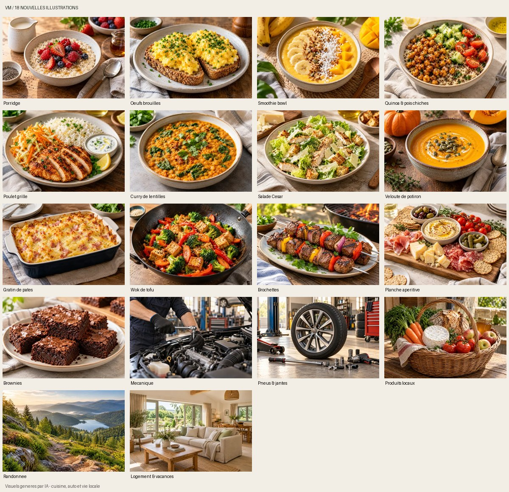

# Illustrations des rubriques VM

18 visuels créés le 23 octobre 2026 avec l’outil image_gen intégré : 13 plats correspondant aux 13 recettes existantes, mécanique, pneus et jantes, produits locaux, randonnée, logement et vacances. Les instructions de génération sont conservées dans [provenance.json](../assets/illustrations/provenance.json).

## Intégration

- `/recettes/` : une illustration propre à chaque recette, conservée lorsque les filtres changent ; photo d’introduction réutilisant la planche apéritive.
- `/pro-auto/` : deux photos d’ambiance pour la mécanique et les pneus, en conservant les images de marque et les catégories existantes.
- `/produits-locaux/`, `/sport/`, `/immo/` : un visuel de présentation adapté au sujet.
- `/demos/garage.html` et `/demos/resto.html` : ambiances photographiques et galeries, avec réutilisation des photos de pizza et tiramisu déjà présentes ; prix et contenus des modèles fictifs conservés.
- VM Univers : cinq cartes de l’annuaire illustrées avec les mêmes thèmes, fichiers hébergés dans son propre dépôt.
- Référence de fond corrigée dans `meteo/portal.css` : le fichier du dépôt média se trouve dans `/vm-location/img/hero.webp`.

Les fichiers livrés sont des WebP locaux de 480 et 960 pixels de large, soit 36 variantes dans ce dépôt, de 30 à 171 ko chacune (environ 3 Mo au total). Les images des recettes utilisent `srcset` et un chargement différé. Les dimensions réservées et `object-fit` limitent les sauts de mise en page. Les images de présentation disposent de textes alternatifs. La version du cache propre au site passe à v7 ; l’isolation des caches est conservée.

Les visuels sont signalés comme illustrations générées par IA. Ils ne représentent ni un professionnel réel référencé, ni une annonce immobilière disponible. Aucune fiche de producteur, annonce ou référence client fictive n’est ajoutée. Les démonstrations métiers et leurs images précédemment intégrées sont conservées.

## Vérification

- Ouverture et inspection des 18 images, contrôle des dimensions et décodage des 36 WebP ; chaque fichier reste inférieur à 220 ko.
- Contrôle des références d’images HTML locales dans les deux dépôts, y compris les cinq fonds de cartes modifiés ; aucune référence manquante relevée.
- Exécution du rendu JavaScript des recettes sous Node : 13 cartes, trois repas du jour, filtres vegan (six cartes), vegan/minceur (deux cartes) et absence de résultat vérifiés.
- Syntaxe JavaScript et `git diff --check` validés. Les ingrédients, étapes et critères des recettes ne sont pas modifiés.
- Limite : le navigateur Chromium local se termine avec SIGTRAP dans cet environnement. L’affichage des pages à 320, 390 et 1 440 pixels n’a donc pas été validé au navigateur pendant cette livraison. Le contrôle des images ne constitue pas un contrôle de l’affichage en production.

Les modifications sont préparées dans une branche dédiée. Aucune activation de statistiques, souscription, modification de formulaire, clé de compte ou réintroduction des anciens compteurs. La publication nécessite la fusion de la modification.
